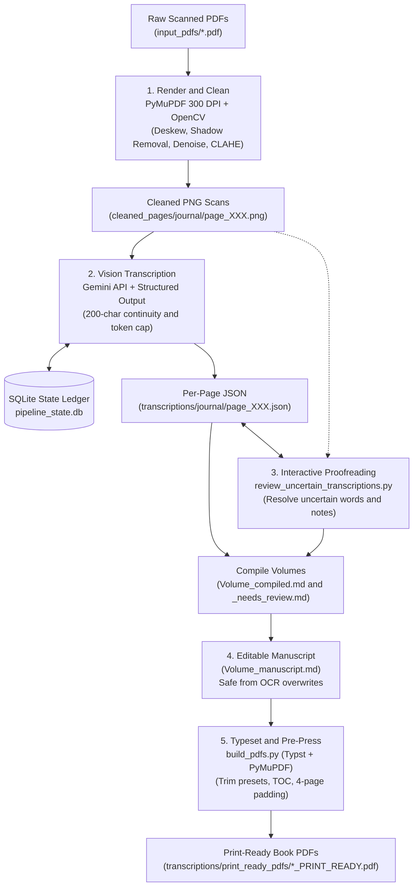

# Archival Journal & Typewriter Digitisation Pipeline

An automated, fault-tolerant Python pipeline for converting scanned or photocopied PDFs of historical typewritten manuscripts and handwritten journals into clean images, proofread Markdown manuscripts, and print-ready typeset book PDFs using **PyMuPDF**, **OpenCV**, the **Google Gemini Vision API**, and **Typst**.

---

## Pipeline Overview



---

## Features

* **Photocopy Restoration (OpenCV):** Automatically deskews crooked scans, flattens dark gutter shadows via morphological division normalization, strips toner speckle with edge-preserving Non-Local Means denoising, and enhances faint ink with CLAHE.
* **Context-Aware Vision Transcription:** Uses Gemini structured outputs (`Pydantic`) to transcribe degraded typewriter text and handwritten annotations while passing the trailing 200 characters of each page to the next for cross-page sentence continuity.
* **Idempotent & Fault-Tolerant State Ledger:** Tracks every cleaned image, transcribed page, tail context, and token count in a local SQLite database (`pipeline_state.db`) using atomic file writes (`.tmp` → `os.replace`). Interrupted runs resume on the exact page they stopped.
* **Hard Cost Circuit Breaker:** Enforces a strict client-side token cap before every API call, plus exponential backoff for `429` / `5xx` API errors.
* **Interactive Proofreading CLI:** Isolates ambiguous or faded readings into an `uncertain_words` list and provides an interactive CLI tool (`review_uncertain_transcriptions.py`) that opens each cleaned PNG scan alongside the terminal to resolve flags and curate archivist notes one by one.
* **Flexible Multi-Volume Stitching:** Group multiple PDFs into unified multi-part volumes or compile standalone books per PDF via `config.json`.
* **Print-Ready Book Typesetting (Typst):** Converts reviewed Markdown into an editable manuscript (`*_manuscript.md`) and typesets monochrome, print-ready PDFs with front matter (half-title, dynamic colophon, full title, Table of Contents), running headers/footers, five print trim presets, optional Omnibus compilation, automatic 4-page signature padding, and spine width estimation.

---

## Project Structure

```text
book_project/
├── input_pdfs/                         # Drop raw scanned PDFs here (Git-ignored)
├── cleaned_pages/                      # Auto-generated deskewed & whitened PNGs (Git-ignored)
├── transcriptions/                     # Auto-generated JSONs, ledger, Markdown & PDFs (Git-ignored)
│   ├── pipeline_state.db               # SQLite progress & token usage ledger
│   ├── <Volume>_compiled.md            # Compiled OCR Markdown with page markers
│   ├── <Volume>_needs_review.md        # Checklist of uncertain words & scan paths
│   ├── <Volume>_manuscript.md          # Editable manuscript copy (safe from OCR overwrites)
│   └── print_ready_pdfs/               # Generated Typst sources & print-ready PDFs
│       ├── <Volume>_print.typ
│       └── <Volume>_PRINT_READY.pdf
├── transcribe_typewritten_script.py    # Stage 1: PDF extraction, OpenCV cleanup & Gemini transcription
├── review_uncertain_transcriptions.py  # Stage 2: Interactive human-in-the-loop proofreading CLI
├── build_pdfs.py                       # Stage 3: Typst book typesetting & pre-press PDF builder
├── config.example.json                 # Template configuration (copied to config.json on first run)
├── config.json                         # Local volume groupings, author context & book metadata (Git-ignored)
├── .env.example                        # Template for environment variables
├── .env                                # Private GEMINI_API_KEY (Git-ignored)
├── requirements.txt                    # Python package dependencies
└── LICENSE
```

---

## 1. Installation & Setup

### Prerequisites
* Python 3.10+
* A Google Gemini API key from [Google AI Studio](https://aistudio.google.com/)

### Install Dependencies
Create and activate a virtual environment, then install the required packages (including `typst` for PDF typesetting):

**Windows (PowerShell):**
```powershell
python -m venv .venv
.\.venv\Scripts\Activate.ps1
pip install -r requirements.txt
```

**macOS / Linux / Git Bash:**
```bash
python3 -m venv .venv
source .venv/bin/activate
pip install -r requirements.txt
```

### Set Your API Key
Copy `.env.example` to `.env` (or create a new `.env` file in the root directory) and add your API key:

```ini
GEMINI_API_KEY="AIzaSyYourActualKeyHere..."
```

---

## 2. Configuration (`config.json`)

On your first run, the pipeline automatically copies `config.example.json` to `config.json` if one does not exist. Edit `config.json` to match your manuscript details, book metadata, and volume structure:

```json
{
  "model": "gemini-3.8-flash",
  "dpi": 300,
  "max_allowed_tokens": 500000,
  "input_dir": "./input_pdfs",
  "clean_img_dir": "./cleaned_pages",
  "output_dir": "./transcriptions",
  "author_context": "British English spelling and idioms. 20th-century typewritten pages with occasional handwritten edits.",
  "known_entities": [
    "Example Surname",
    "Example Town"
  ],
  "book_metadata": {
    "title": "Collected Journals & Memoirs",
    "subtitle": "",
    "author": "Author Name",
    "edition": "First Edition",
    "publisher_note": "Privately printed family edition.",
    "transcribed_by": "",
    "edited_by": ""
  },
  "volumes": [
    {
      "title": "Volume 1",
      "output_prefix": "Volume_1",
      "pdfs": ["01_part1.pdf"]
    },
    {
      "title": "Volume 2",
      "output_prefix": "Volume_2",
      "pdfs": [
        "02_part2.pdf",
        "03_part3.pdf"
      ]
    }
  ]
}
```

> **Note:** If you leave `"volumes": []` empty, `transcribe_typewritten_script.py` automatically processes every `.pdf` in `./input_pdfs` as its own standalone volume, and `build_pdfs.py` auto-discovers any `*_manuscript.md` or `*_compiled.md` files in `./transcriptions`.

---

## 3. Running the Pipeline

### Step 1: Clean Images & Transcribe Pages
Place your source PDFs in `input_pdfs/` and run:

```bash
python transcribe_typewritten_script.py
```

* **Pausing & Resuming:** Press `Ctrl+C` at any time. The script compiles all pages completed so far into Markdown and exits cleanly. Re-running skips all completed pages and resumes where it left off.
* **Re-compiling Markdown Only:** If you manually edit any `page_XXX.json` files and want to rebuild the compiled Markdown volumes without making new API calls:
  ```bash
  python transcribe_typewritten_script.py --compile-only
  ```
* **Custom Config Path:** All three scripts accept `-c` / `--config path/to/config.json`.

---

### Step 2: Proofread Uncertain Words & Notes
Whenever the model encounters smudged ink, photocopy cutoff, or ambiguous cursive, it wraps its guess in brackets (e.g., `[Basingstoke?]`) and logs alternatives in the page's JSON file.

To step through flagged words interactively with the cleaned page scan open alongside your terminal, run:

```bash
python review_uncertain_transcriptions.py
```

During the interactive session, the cleaned `.png` for the current page opens automatically in your default image viewer, and you can choose:
* **`[Enter]`** — Accept the model's guess and strip the `[...]` brackets.
* **`[1-9]`** — Select one of the model's suggested alternative readings.
* **`[k]`** — Keep the word bracketed as `[guess?]` in the final book (for educated guesses), but clear it from the review queue.
* **`[i]`** — Replace the word with `*[illegible]*`.
* **`[s]`** — Skip for later and leave in the review queue.
* **Custom text** — Type any replacement word or phrase and press Enter.

Every decision is saved atomically to `page_XXX.json` immediately, and volumes are re-compiled when the session finishes or pauses (`Ctrl+C`).

#### Optional Editorial Note Flags
* **Review & curate AI archivist notes** (keep, delete noisy OCR notes, or rewrite them into family footnotes):
  ```bash
  python review_uncertain_transcriptions.py --review-notes
  ```
* **Include remaining archivist/editorial notes** as blockquotes in the compiled book Markdown:
  ```bash
  python review_uncertain_transcriptions.py --with-notes
  ```

---

### Step 3: Edit Manuscripts & Build Print-Ready Book PDFs
Once proofreading is complete, run `build_pdfs.py` to generate print-ready book PDFs in `transcriptions/print_ready_pdfs/`:

```bash
# Build individual print-ready PDFs for each volume (default: Royal 156mm x 234mm)
python build_pdfs.py

# Combine all volumes into a single Omnibus Edition PDF
python build_pdfs.py --omnibus

# Choose a different trim size and override title/author from config.json
python build_pdfs.py --omnibus --trim bformat --title "My Family Memoirs" --author "J. Smith"
```

> **Note:** `build_pdfs.py` reads directly from `transcriptions/` and does **not** require the original raw PDFs in `input_pdfs/` to be present on disk.

#### Editable Manuscript Workflow (`*_manuscript.md`)
On its first run, `build_pdfs.py` creates an editable `<Volume>_manuscript.md` from `<Volume>_compiled.md`, stripping mechanical `---` and `## Page X` OCR markers. Subsequent runs read `<Volume>_manuscript.md` without overwriting your edits.

You can format your manuscript using the following Markdown conventions:

| Syntax | Rendered Book Output |
| :--- | :--- |
| `## Chapter Title` | Starts a new chapter on a fresh page and adds an entry to the Table of Contents |
| `### Subheading` | Inline date or section heading (no page break) |
| `***` | Centred literary scene break (`* * *`) |
| `[pagebreak]` | Forces a manual page break |
| `[footer: text]` | Unnumbered italic footer pinned to the bottom of the page |
| `^[footnote text]` | Inline numbered footnote |
| `> *Note: text*` | Paragraph-level numbered footnote (also matches `> *Editorial Note: ...*`) |
| Two or more blank lines | Explicit vertical spacing (`1.5em`) |

Common Windows-1252 / UTF-8 mojibake (e.g. `£`, em-dashes, smart quotes) and spaced `--` hyphens are automatically normalized during typesetting.

#### Supported Print Trim Presets (`--trim`)

| Preset | Dimensions | Font Size | Gutter / Outer Margins | Typical Use Case |
| :--- | :--- | :--- | :--- | :--- |
| `royal` *(default)* | 156 mm × 234 mm | 10.5 pt | 22 mm / 16 mm | Classic UK hardback memoir (BookVault / Mixam / Lulu) |
| `demy` | 138 mm × 216 mm | 9.75 pt | 19 mm / 14 mm | Compact UK literary hardback / larger paperback |
| `bformat` | 129 mm × 198 mm | 9.5 pt | 18 mm / 13 mm | Standard UK commercial paperback |
| `ustrade` | 152.4 mm × 228.6 mm | 10.25 pt | 21 mm / 15 mm | 6" × 9" US Trade standard |
| `a5` | 148 mm × 210 mm | 10 pt | 20 mm / 15 mm | Standard A5 (Mixam / Doxdirect) |

#### Pre-Press Finalization
After Typst compiles each PDF, `build_pdfs.py` automatically:
1. Pads the PDF with blank end-pages so the total page count is a multiple of 4 (required for print signatures).
2. Prints the final page count and estimated spine width for 80 gsm paper and 90–100 gsm cream bookwove.
3. Outputs in monochrome grayscale (`luma`) suitable for black-and-white book printing.

---

## 4. Troubleshooting & Resetting State

* **Re-transcribing a specific page:** Delete `transcriptions/<journal_name>/page_XXX.json` and re-run `python transcribe_typewritten_script.py`. The pipeline checks both the SQLite flag *and* file existence on disk, so deleting a JSON file forces that single page to be re-transcribed.
* **Re-cleaning a specific page image:** Delete `cleaned_pages/<journal_name>/page_XXX.png` and re-run `python transcribe_typewritten_script.py`.
* **Regenerating an editable manuscript:** Delete `transcriptions/<Volume>_manuscript.md` and re-run `python build_pdfs.py` to recreate it from `<Volume>_compiled.md`.
* **Debugging Typst compilation errors:** Inspect the generated `.typ` file saved in `transcriptions/print_ready_pdfs/` for any unescaped syntax or malformed manuscript markers.
* **Checking total token usage:** Run this one-liner to inspect your SQLite ledger:
  ```bash
  python -c "import sqlite3; c = sqlite3.connect('transcriptions/pipeline_state.db'); print(c.execute('SELECT COUNT(*), SUM(transcribed), SUM(prompt_tokens), SUM(output_tokens) FROM page_progress').fetchone())"
  ```
